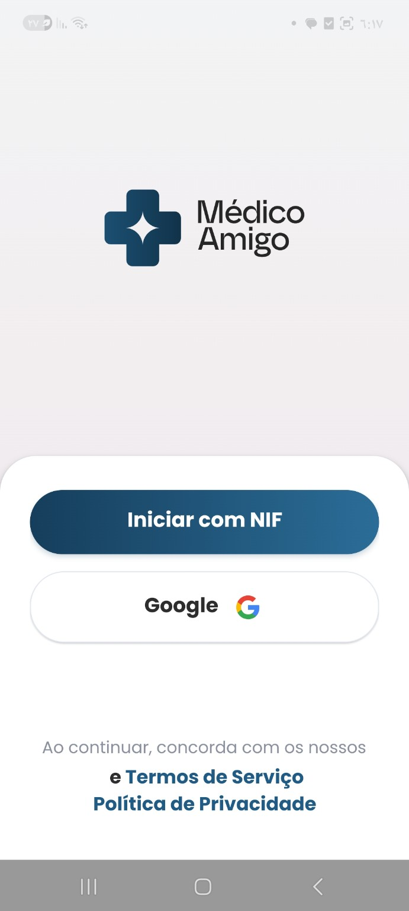
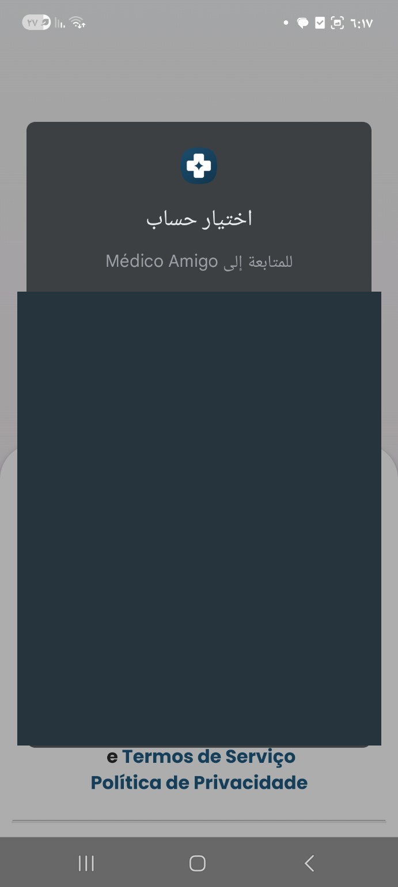
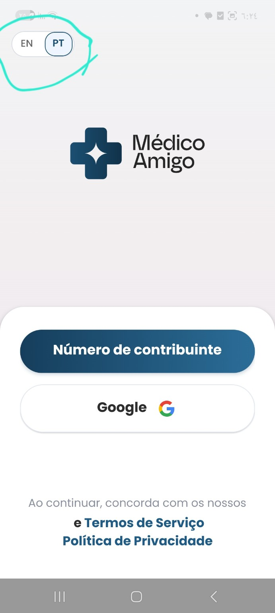
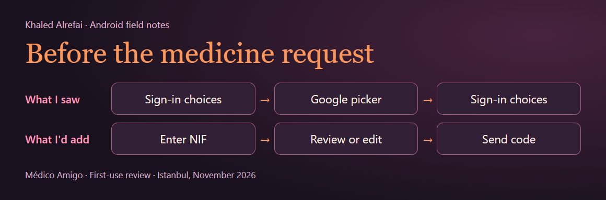
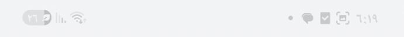
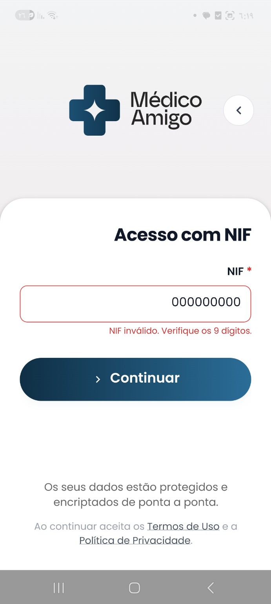
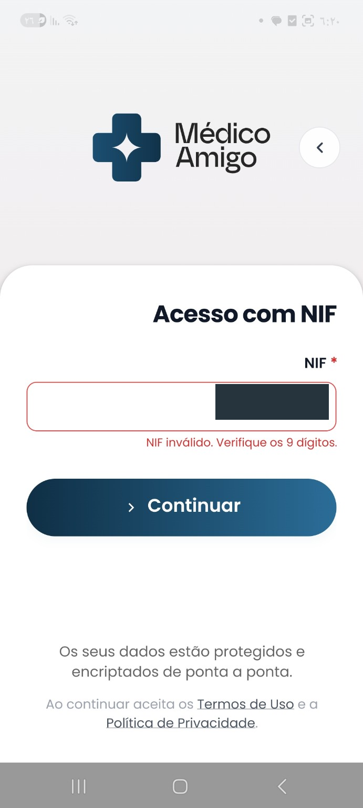
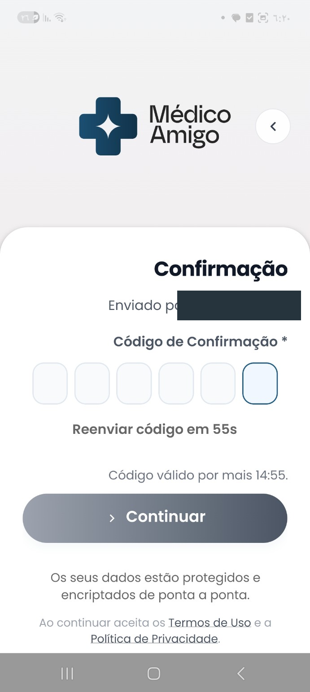

# Before the medicine request

Khaled Alrefai · Android · Istanbul · 23 November 2026

[Web edition](https://kaldx5.github.io/medico-amigo-qa-audit/) · [Illustrated PDF](field-notes.pdf)

## Sign-in across two visits

<table><tr><td align="center" width="33%"> First visit. I could not see a language switch.</td><td align="center" width="33%"> Google opened its account picker. I chose my account and returned to sign-in.</td><td align="center" width="33%"> After reopening. The EN / PT switch appeared.</td></tr></table>

I opened Médico Amigo to see how a patient requests medication. I reached the sign-in choices and the NIF verification flow. I do not have a Portuguese tax number of my own, so my review ends before the request.

## Choosing my Google account

I tapped Google, picked my account and found myself looking at the same two buttons again. I saw no message. Should I retry, or did I need a NIF anyway? One line explaining the next step would have helped.

## One step back

On the NIF entry screen I changed my mind and pressed Back to try Google. I ended up outside the app. I reopened it to get back to the two choices I had just seen.

## Finding English on my second visit

I could not see a language switch the first time. After I removed the app from recent apps and reopened it, EN / PT appeared. The NIF button wording changed too. I wanted that language choice before I had to interpret the first prompt.

## One change I would make

Show the NIF for review before requesting a code. I would give the patient a chance to correct a mistyped digit and make the effect of the next tap explicit.

### Reading the status bar

The clock and connection icons looked faint on my phone. Stronger contrast would make them easier to read at a glance.

## Before sending a code

I liked that the field stopped at nine digits and gave feedback on invalid input. What surprised me was going from “Continuar” to a message saying a code had been sent. I had expected one more chance to review the digits. I stopped at that screen.

<table><tr><td align="center" width="33%"> The field rejected the all-zero entry.</td><td align="center" width="33%"> A validation message was also visible during my second entry.</td><td align="center" width="33%"> Later I reached the code screen. The destination is covered.</td></tr></table>

### Where I stopped

With a demo profile I would change a medicine selection before confirming it and check how the app tells me when a clinician receives the request.
