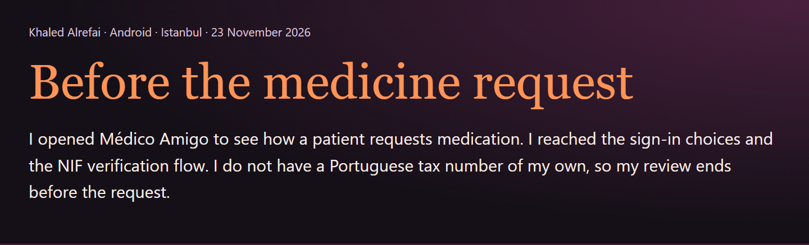
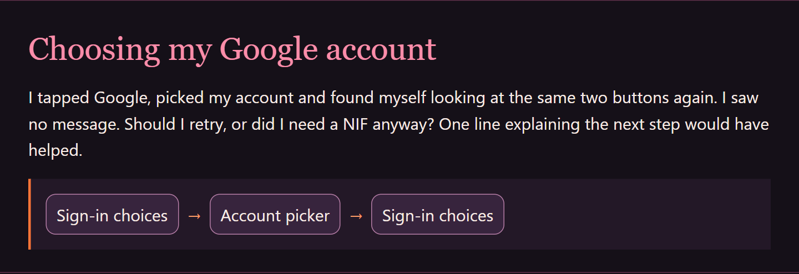
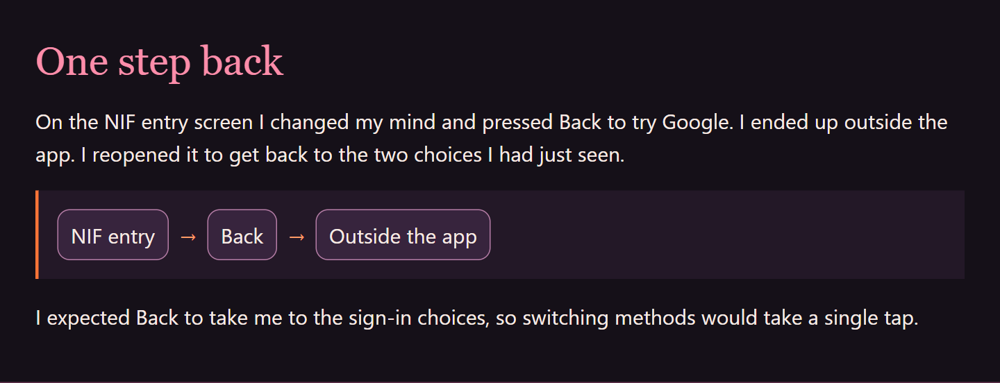
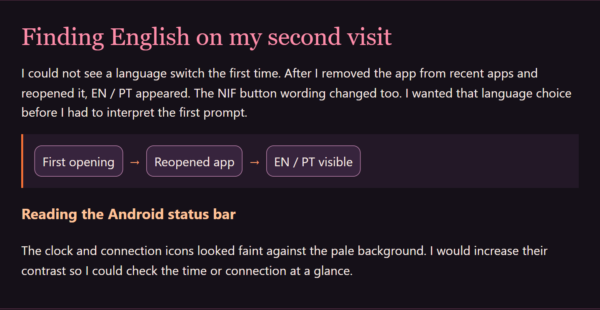
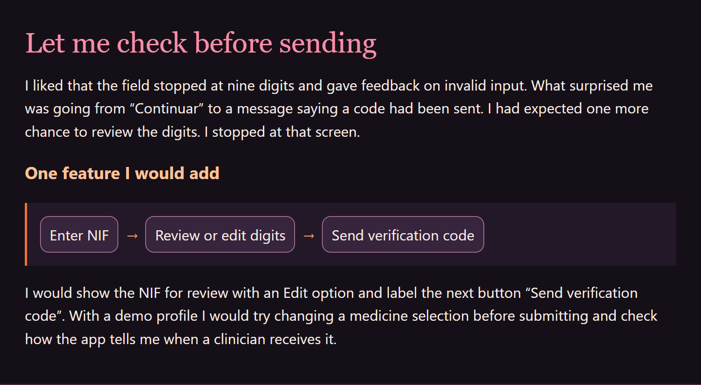

[Open the interactive edition](https://kaldx5.github.io/medico-amigo-qa-audit/) · [Download the PDF](field-notes.pdf)

Read as text

### Before the medicine request

I opened Médico Amigo to see how a patient requests medication. I reached the sign-in choices and the NIF verification flow. I do not have a Portuguese tax number of my own, so my review ends before the request.

### Choosing my Google account

I tapped Google, picked my account and found myself looking at the same two buttons again. I saw no message. Should I retry, or did I need a NIF anyway? One line explaining the next step would have helped.

Sign-in choices → Account picker → Sign-in choices

### One step back

On the NIF entry screen I changed my mind and pressed Back to try Google. I ended up outside the app. I reopened it to get back to the two choices I had just seen.

NIF entry → Back → Outside the app

I expected Back to take me to the sign-in choices, so switching methods would take a single tap.

### Finding English on my second visit

I could not see a language switch the first time. After I removed the app from recent apps and reopened it, EN / PT appeared. The NIF button wording changed too. I wanted that language choice before I had to interpret the first prompt.

First opening → Reopened app → EN / PT visible

### Reading the Android status bar

The clock and connection icons looked faint against the pale background. I would increase their contrast so I could check the time or connection at a glance.

### Let me check before sending

I liked that the field stopped at nine digits and gave feedback on invalid input. What surprised me was going from “Continuar” to a message saying a code had been sent. I had expected one more chance to review the digits. I stopped at that screen.

### One feature I would add

Enter NIF → Review or edit digits → Send verification code

I would show the NIF for review with an Edit option and label the next button “Send verification code”. With a demo profile I would try changing a medicine selection before submitting and check how the app tells me when a clinician receives it.

