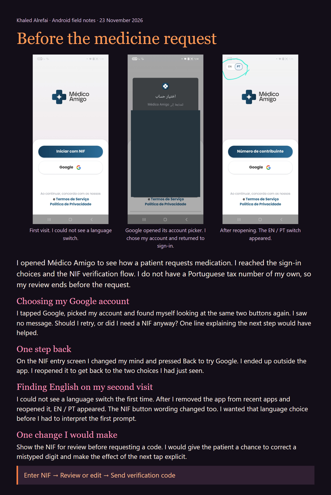
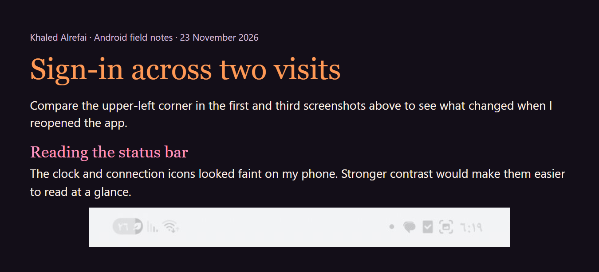
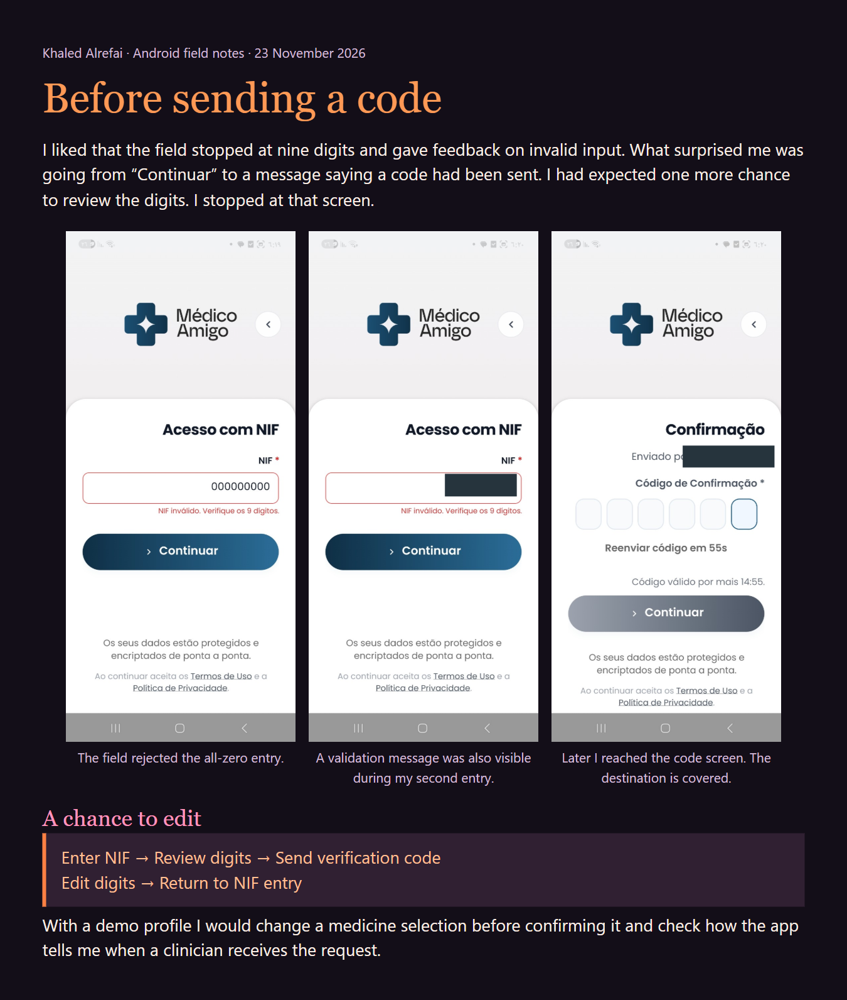

# Médico Amigo · Android field report

<a href="https://kaldx5.github.io/medico-amigo-qa-audit/"><strong>Read the web edition ↗</strong></a> &nbsp;·&nbsp; <a href="docs/field-notes.pdf">Open the illustrated PDF</a>

<a href="https://kaldx5.github.io/medico-amigo-qa-audit/"><picture><source media="(max-width: 650px)" srcset="docs/assets/showcase/sign-in-mobile.png"></picture></a>

<a href="https://kaldx5.github.io/medico-amigo-qa-audit/#status-bar"><picture><source media="(max-width: 650px)" srcset="docs/assets/showcase/status-bar-mobile.png"></picture></a>

<a href="https://kaldx5.github.io/medico-amigo-qa-audit/#review"><picture><source media="(max-width: 650px)" srcset="docs/assets/showcase/verification-mobile.png"></picture></a>

Read the report as text

### Before the medicine request

First visit. I could not see a language switch.

Google opened its account picker. I chose my account and returned to sign-in.

After reopening. The EN / PT switch appeared.

I opened Médico Amigo to see how a patient requests medication. I reached the sign-in choices and the NIF verification flow. I do not have a Portuguese tax number of my own, so my review ends before the request.

### Choosing my Google account

I tapped Google, picked my account and found myself looking at the same two buttons again. I saw no message. Should I retry, or did I need a NIF anyway? One line explaining the next step would have helped.

### One step back

On the NIF entry screen I changed my mind and pressed Back to try Google. I ended up outside the app. I reopened it to get back to the two choices I had just seen.

### Finding English on my second visit

I could not see a language switch the first time. After I removed the app from recent apps and reopened it, EN / PT appeared. The NIF button wording changed too. I wanted that language choice before I had to interpret the first prompt.

### One change I would make

Show the NIF for review before requesting a code. I would give the patient a chance to correct a mistyped digit and make the effect of the next tap explicit.

Enter NIF → Review or edit → Send verification code

### Sign-in across two visits

Compare the upper-left corner in the first and third screenshots above to see what changed when I reopened the app.

### Reading the status bar

The clock and connection icons looked faint on my phone. Stronger contrast would make them easier to read at a glance.

### Before sending a code

I liked that the field stopped at nine digits and gave feedback on invalid input. What surprised me was going from “Continuar” to a message saying a code had been sent. I had expected one more chance to review the digits. I stopped at that screen.

The field rejected the all-zero entry.

A validation message was also visible during my second entry.

Later I reached the code screen. The destination is covered.

### A chance to edit

Enter NIF → Review digits → Send verification code Edit digits → Return to NIF entry

With a demo profile I would change a medicine selection before confirming it and check how the app tells me when a clinician receives the request.

